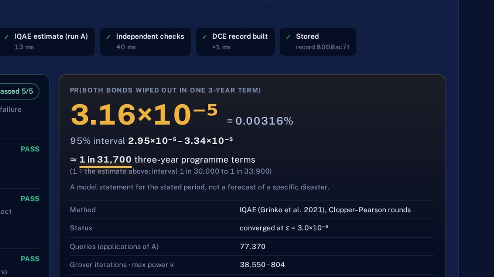

# Tandem: ADB Quantum Challenge prototype

**From joint catastrophe risk to reviewable evidence.**

Tandem is a prototype for the ADB Quantum Innovation Challenge (*Quantum Approaches to Joint-Loss Modelling for Natural Catastrophe Risk*). It answers one question about the two catastrophe bonds the Asian Development Bank issued in 2026 for the Kyrgyz Republic and Tajikistan:

> **What is the probability that both ADB catastrophe bonds are wiped out in the same three-year term?**

Each bond is wiped out in roughly two terms in a thousand. Shared earthquakes and shared rainfall link the two bonds, and a joint wipe-out would exhaust the whole programme at once. That joint event is rare, so plain sampling has a hard time estimating it.

This repository is the **public, sanitised companion** to the submission. It holds the documentation, the narrated demo film, sample results exported from the frozen run, and a description of the prototype. **It does not contain source code** (see [What is withheld](#what-is-withheld)).

**▶ Watch the [Model run video](#model-run-video).**

---

## The result in one table

Frozen demo run: ADB base case, standard precision, seeds 0 and 1, ideal simulation on Qiskit Aer.

| Item | Value |
|---|---|
| Exact reference (continuous-time Markov chain, the brief's method) | **3.163 × 10⁻⁵** (≈ 1 in 31,613 three-year terms) |
| Quantum estimate (Iterative Quantum Amplitude Estimation, IQAE) | **3.159 × 10⁻⁵**, 95% interval 2.95–3.34 × 10⁻⁵ |
| Query budget | 77,370 state preparations; 9 rounds; Grover powers up to 804 |
| Circuit | 13 qubits; the circuit-integrity gate passed all 5 checks before estimating |
| Second IQAE run (fresh seed) | 3.114 × 10⁻⁵, interval 2.86–3.41 × 10⁻⁵ |
| Monte Carlo at the same budget | 0 wipe-outs observed: "not observed", not zero risk |
| Cross-entropy importance sampling at the same budget | 3.71 × 10⁻⁵, interval 2.17–5.25 × 10⁻⁵ (about 8× wider) |
| Many runs at 8,192 queries | relative error: Monte Carlo 189% (measured over 200 runs), IQAE 49% (20 seeds) |
| DCE decision | **Ready to use** (ACCEPT), confidence 0.80 |
| Reproducibility | 3 in-process runs bit-identical; "Reproduce from record" returns all 8 stored outputs unchanged |

**Claim boundary.** These are model estimates from an ideal simulator. **No quantum hardware was used.** The comparison is accuracy **per query**, not wall-clock time: for two countries the exact classical calculation is still the fastest method. We claim no quantum advantage. The outputs are not prices, ratings, forecasts or investment advice.

## Model run video

[](evidence/Model%20run%20video.mp4)

**[▶ Model run video](evidence/Model%20run%20video.mp4)** (4 min 36 s, 1080p60, narrated; [download](https://github.com/Abhinav-Mathew-Kurian/ADB-QuantumChallenge-KBS/raw/main/evidence/Model%20run%20video.mp4)). It has an English subtitle track, also available as [`captions_en.srt`](evidence/captions_en.srt).

The film was recorded frame by frame from the live application running the frozen model run. No frames are mocked up.

## Repository map

```
ADB-QuantumChallenge-KBS/
├── README.md                      this page
├── requirements.txt               runtime stack the results were produced with (pinned)
├── docs/
│   ├── TECHNICAL_OVERVIEW.md      model, circuit, IQAE, integrity gate, independent checks, DCE, architecture
│   ├── RESULTS_AND_VALIDATION.md  frozen-run results, benchmark across 25 cells, validation and tests
│   ├── RESOURCE_PROFILE.md        qubits, depth, gates, queries, error mitigation, fault-tolerant estimate
│   ├── PHASE_2_PLAN.md            objectives, work packages, risks, resources
│   └── AI_TOOLS_DISCLOSURE.md     which AI tools were used, for what, and how their output was controlled
├── evidence/
│   ├── Model run video.mp4        narrated demo film
│   ├── captions_en.srt            subtitles
│   ├── poster.jpg
│   └── sample-results/            CSV/JSON exported from the frozen run and the benchmark evidence
└── prototype/
    ├── README.md                  what the prototype does, its components and interfaces (no code)
    └── screens/                   14 screenshots of the running application, in storyboard order
```

## How the prototype works (short)

1. **Exact model.** We transcribe the brief's two-country model (a 25-state quarter-step earthquake chain with shared events, plus a shared and local precipitation trigger) and reproduce all 25 reference values in the brief's Table 5.
2. **Structured state preparation.** A **13-qubit** loader whose rotation angles are closed-form functions of per-country quantities. It never integrates the joint distribution, so it grows linearly with the number of countries.
3. **Circuit-integrity gate.** Before any estimate, five checks compare the circuit with the exact model: the probability, the full joint wipe-out pattern, the oracle, Grover amplification for k = 1, 2, 3, and finally proof that amplitude estimation was used. If any check fails, the run is blocked.
4. **Amplitude estimation.** IQAE with rigorous Clopper–Pearson intervals.
5. **Independent checks at the same budget.** Exact reference, a second IQAE seed, Monte Carlo and cross-entropy importance sampling.
6. **DCE record** (Decision, Confidence, Evidence). Every run is stored immutably with its input hash, model fingerprint, circuit hash, seeds, budget and software versions. It can be reproduced, reviewed, exported or printed.
7. **Worst-case drivers.** Amplitude amplification draws 1,000 wipe-out scenarios from the same frozen model at 279 queries each, where rejection sampling would need about 31,600 tries each.

Details: [docs/TECHNICAL_OVERVIEW.md](docs/TECHNICAL_OVERVIEW.md).

## What is withheld

This public repository deliberately leaves out:
- **all source code**: the quantum service, the evidence gateway, the web application, test suites, evidence and recording scripts;
- the internals of the DCE trust layer beyond what the application displays;
- the organisers' evaluation harness, private hold-out suites, and webinar material, which are third-party or confidential;
- internal planning documents, credentials and machine-specific configuration.

The code is available to the challenge organisers and judges on request. Every number in this repository was exported from the committed evidence of the frozen build; none was typed in by hand.

## Status

- Phase 1 prototype: complete and frozen (the solver fingerprint, request and expected outputs are recorded in [`evidence/sample-results/joint-wipeout-frozen-run.json`](evidence/sample-results/joint-wipeout-frozen-run.json)).
- Tests at freeze: 443 Python tests, 19 gateway tests, 15 UI unit tests, 67 browser end-to-end checks (passed on consecutive runs), 18/18 pre-recording checks.
- Next: [Phase 2 plan](docs/PHASE_2_PLAN.md), covering hardware execution, data calibration, larger portfolios, and evaluation with ADB staff.

---

© 2026 the Tandem team. All rights reserved. No licence is granted to reuse the material in this repository beyond viewing it for the purposes of the ADB Quantum Innovation Challenge.
